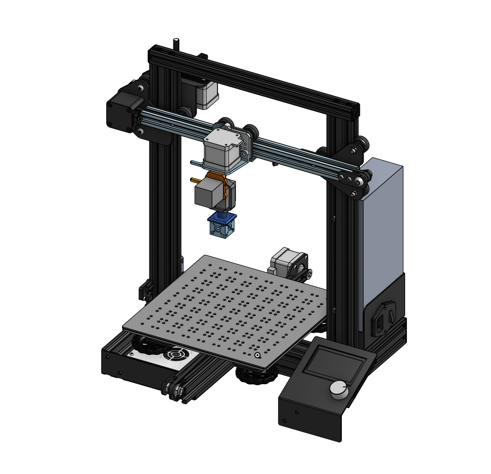
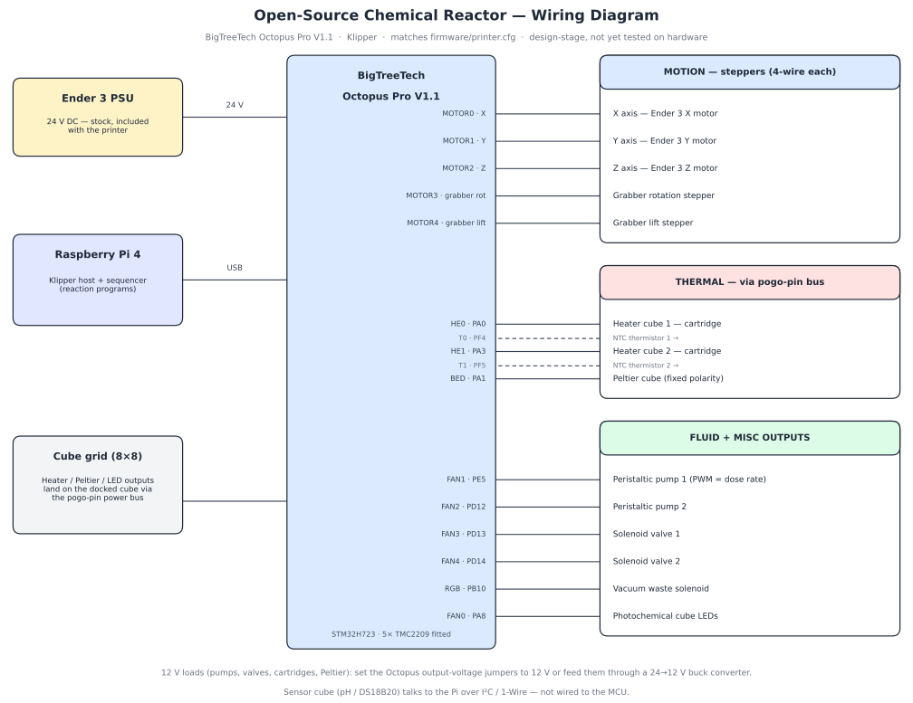

# Open-Source Chemical Reactor

A modular chemical reactor built into an Ender 3 gantry. Magnetic 25 mm cubes snap
together into reaction setups - spring-loaded pogo pins carry power and signal;
genderless spring-loaded fluid connectors (O-ring sealed) carry the chemistry. Each cube is internally sealed with Teflon/PTFE.
Fluids in, product out, byproducts sorted. Design a new cube, share the file, remix the chemistry.

## Why

I built this because I wanted to do chemistry reactions at home without having to assemble the large setup.

## Uses of this machine
Students would be able to synthesize and create new chemicals without having to purchase expensive lab materials and PPE, and would not have to require a team of scientist to do the same work.
College students would be able to quickly make new chemicals and compounds without having to purchase and wait for shipping or funding -> rapid prototyping.
Industries would be able to use this to make a universal chemical creation factory, where one can order a specific chemical compound/formula, and then get it sent back or tested with the industry.

**Full reactor assembly: Ender 3 gantry with the magnet head holding a cube over the perforated bed cover.**
## How it works

- **Cubes** are the unit of chemistry. Each 25 mm cube does one job: move, mix,
  heat, cool, sense, filter, or vent.
- **The gantry** is an Ender 3 motion system with a 200 mm work volume — an
  8×8 grid of cube slots. It places cubes, connects fluid/electrical lines, and
  runs the sequence.
- **Interconnects** are all spring-loaded: pogo pins for electronics, O-ring
  face seals for fluids. Cubes self-align on magnets, so the gantry just drops
  them in with a magnetic manipulator.

## Cube catalog

| Cube | Job |
|---|---|
| Straight | Pass-through channel |
| Elbow | 90° turn |
| T-Mixer | Two inlets merge into one outlet |
| Inlet / Outlet | Fluid enters or leaves the setup |
| Delay | Zigzag channel — residence time without extra footprint |
| Mixer | Herringbone / tortuous geometry for chaotic mixing |
| Heater | Thermal block, looped channel for max contact |
| Photochemical | Internal LEDs drive light-driven reactions |
| Peltier | Rapid heating/cooling — thermal-shock crystallization |
| Sensor | Temperature, pH, or other probes in the flow path |
| Bubbler | Gas sparging through liquid |
| Gravity chimney | Gas vents up and out, liquid stays down |
| Filtration | Filter membrane with filtrate routed to waste |
| Plug | Blank — caps an unused port |

The cubes themselves are open source — the interface is the standard, so anyone can design a new cube to it and share it.

## Materials

- **Wetted path:** PTFE: nothing sticks, nearly nothing reacts
- **Structure:** transparent PETG
- **Energy blocks** (heaters, Peltiers): aluminum or brass
- **Gaskets:** FKM (Viton)

## Fluid path: PTFE sleeves

Every straight fluid bore in a cube is lined with a PTFE sleeve, so reagents
touch PTFE and the face gasket only.

1. **Tube:** PTFE, 2 mm ID × 4 mm OD (see `BOM.csv`).
2. **Bore:** the printed Ø4 bore is reamed by hand to Ø4.1–4.2 mm — printed
   holes come out undersize.
3. **Cut:** sleeve length = bore depth (10 mm blind, 25 mm through). Square
   cut with a razor blade — never pinch-cut with pliers or cutters; a crushed
   ID blocks flow.
4. **Fit:** push the sleeve in from the face, trim it flush with the face.
5. **Lock:** a dab of 2-part epoxy on the sleeve OD at the inner end, inside
   the cube and out of the fluid path.

When two cubes mate, the sleeve ends butt together, and the face gasket seals
the joint. Looped or tortuous channels (mixer, heater) are lined with PTFE
tube routed through the channel where the geometry allows.

Before any new reagent is run, soak a PETG coupon and a spare gasket in it at
the run concentration and temperature — a reagent runs only if its coupon
passes.

## Gantry layout

| Zone | Location |
|---|---|
| Liquid input ×2 | Top of gantry |
| Product output | Corner |
| Discharge / waste | Corner(s) |
| Gas vacuum waste | Dedicated port |
| Pressurized N₂ or air | Optional source |

## Example run: silver precipitation

Ag + 2 HNO₃ → AgNO₃ + NO₂↑ + H₂O

1. Silver and nitric acid meet in a **T-mixer** cube
2. Through a **heater** cube (looped channel)
3. **Gravity chimney** vents NO₂ to vacuum waste
4. **Peltier** cube crash-cools → thermal-shock crystallization
5. **Filtration** cube catches crystals, filtrate goes to waste
6. Wash cycle: nitric acid flush + nitrogen purge
7. Pull the filtration cube (there's your product), cap the line to waste
8. Swap the mixer inlet for **wash manifold** cubes — flush water/nitric to
   waste, dry with nitrogen
9. Inject hot water, route through a **T**: pressurized air pushes the slurry
   out through an **L** to the output
10. Dry with heater or gas — done

## Files

- `CAD/` — reactor add-on parts (STEP, no stock Ender 3 parts): 25mm cube, hotbed cover plate, and carriage parts (Parts 2–9); full assembly in `CAD/01_MAIN_ASM_Ender_3.step.zip` (unzip for the .STEP — the raw 48 MB .STEP is too large to upload to GitHub directly, so the assembly is stored zipped)
- `firmware/printer.cfg` — Klipper configuration for the Manta M5P controller
- `docs/wiring-diagram.svg` — wiring diagram
- `BOM.csv` — full parts list with links and prices
- `docs/cube-face-layout.md` — magnet head design + cube face template (old spacing, superseded by the 4/7 diagram below)
- `docs/face-layout.svg` — face template diagram (old spacing, superseded by the 4/7 diagram below)
- `docs/cube-face-template-gasket.png` — cube face template diagram, square 4/7 layout with FKM gasket seal (current)
- `docs/full-assembly.png` — full-assembly screenshot

Stock Ender 3 base in the full assembly: "Creality Ender 3" by Allen Kreager, public Onshape document (https://cad.onshape.com/documents/4c5c153cb677461d7144eeb2/w/43449f3437d39d936d31fb85).

## Wiring

Pin-by-pin details are in the header of [firmware/printer.cfg](firmware/printer.cfg).

## ⚠️ Safety

> [!WARNING]
> **Design-stage project — not built or tested yet.** The example run uses concentrated nitric acid and produces nitrogen dioxide (NO₂), a toxic gas. Any real run requires a fume hood and chemical PPE (goggles, gloves, lab coat), plus proper chemical waste disposal. Heater cubes reach burn temperatures, the system uses pressurized gas, and the controller runs off a mains-powered supply. Never run the machine unattended, and pressure-test every cube seal with water before using real reagents.

## License
Hardware design (CAD) is licensed under CERN-OHL-S v2 — see LICENSE-HARDWARE. Everything else is under MIT — see LICENSE.
